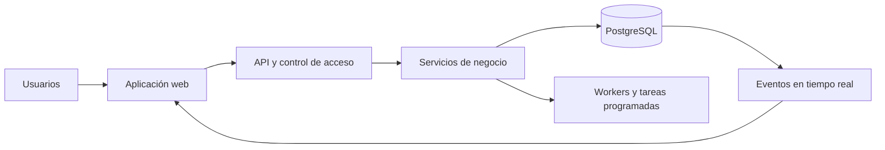

# ABYSS STCW — Brief técnico público

**Estado:** puesta en producción durante mi etapa, finalizada en abril de 2026. No informo sobre su estado actual.

**Alcance público:** capacidades, arquitectura y decisiones de producto

**Confidencial:** nombres propios, URL operativa, código fuente, datos, secretos y detalles comerciales

ABYSS STCW es una plataforma modular de gestión de formación marítima. Integra en un mismo sistema los procesos comerciales, académicos, documentales y operativos necesarios para acompañar el ciclo completo, desde la captación y la matrícula hasta el seguimiento, la certificación, la facturación y la mejora continua.

Este repositorio es una ficha técnica pública. Permite revisar el alcance y el criterio de diseño del producto sin exponer la implementación ni información sensible.

## Mi aportación

Llevé el proyecto desde la comprensión de las necesidades y la planificación funcional hasta su puesta en producción. Mi etapa finalizó en abril de 2026. Mi trabajo incluyó:

- conceptualización del producto y de sus procesos principales;
- traducción de necesidades operativas en módulos, flujos y prioridades;
- definición de la arquitectura funcional y coordinación técnico-funcional;
- integración progresiva de áreas que antes operaban de forma separada;
- definición de controles, trazabilidad y documentación operativa;
- seguimiento de incidencias y mejora continua sobre el uso real del sistema.

Mi función no se limita a una tecnología concreta: consiste en convertir problemas de negocio en sistemas coherentes, gobernables y preparados para evolucionar.

## Capacidades documentadas

- captación, seguimiento y conversión de oportunidades;
- gestión de alumnos, expedientes y ciclo académico;
- plantillas, convocatorias, horarios, recursos y asistencia;
- evaluaciones, materiales y portal de autoservicio;
- certificaciones y flujos documentales verificables;
- facturación y seguimiento de cobros;
- comunicaciones, tareas y automatizaciones programadas;
- informes, indicadores y procesos de calidad;
- usuarios, permisos y acceso basado en roles.

## Arquitectura resumida

- frontend: `React 18`, `Vite`, `JavaScript / JSX`;
- interfaz: `Tailwind CSS`, componentes accesibles, animación y visualización de datos;
- backend: `Node.js`, `Express`, servicios, middleware y workers;
- datos: `PostgreSQL` y migraciones versionadas;
- seguridad: autenticación `JWT`, sesiones y `RBAC`;
- procesamiento: colas, tareas programadas y workers;
- tiempo real: `Socket.IO` y eventos de PostgreSQL;
- operación: supervisión de procesos, proxy inverso, comprobaciones y procedimientos de recuperación.

La descripción por capas está en [Arquitectura](./docs/architecture.md).

## Principios de producto

- el proceso se diseña de extremo a extremo, no como pantallas aisladas;
- la seguridad y los permisos se aplican también en backend;
- las operaciones relevantes deben ser trazables;
- los procesos asíncronos requieren estados, reintentos y recuperación;
- la configuración específica debe permanecer fuera del núcleo común;
- la evolución se realiza por fases verificables, preservando la operación existente.

## Evolución de plataforma

La base técnica permite separar configuración, identidad y reglas específicas del núcleo reutilizable. Esta línea se desarrolla de forma incremental y no se presenta aquí como una generalización completa. El estado público y sus límites están descritos en [Evolución de plataforma](./docs/platform-expansion-status.md).

## Límite de publicación

Este repositorio no publica ni permite deducir:

- nombres propios vinculados a la operación;
- URL o infraestructura operativa;
- código fuente privado;
- datos reales o documentos generados;
- secretos, credenciales o configuración sensible;
- acuerdos, condiciones o información comercial.

El hecho público relevante es que la plataforma fue puesta en producción durante mi etapa, finalizada en abril de 2026. Esta ficha no afirma cuál es su estado actual.

## Ruta de revisión

1. Leer este brief.
2. Revisar [Arquitectura](./docs/architecture.md).
3. Revisar [Evolución de plataforma](./docs/platform-expansion-status.md).
4. Consultar el [prompt maestro sanitizado](./prompts/00_prompt_maestro_expansion_abyss.md) como muestra del enfoque de planificación.

## Contacto profesional

- GitHub: [Robertgaraban](https://github.com/Robertgaraban)
- LinkedIn: [Robert Garabán](https://www.linkedin.com/in/robertgaraban)

> Esta ficha describe capacidades y decisiones de diseño. No es una distribución del producto ni una vía de acceso al entorno operativo.
