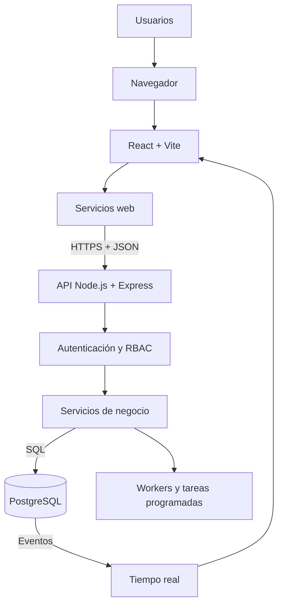

# Arquitectura pública de ABYSS STCW

## Visión general

ABYSS STCW es una plataforma modular de gestión de formación marítima que fue puesta **en producción durante mi etapa, finalizada en abril de 2026**. Su arquitectura integra una aplicación web, una API de negocio, persistencia relacional, procesamiento asíncrono y controles de acceso por roles. Esta ficha no informa sobre su estado actual.

Esta descripción se limita a patrones y tecnologías defendibles. Quedan fuera de publicación los nombres propios, la URL operativa, la topología concreta, el código, los datos y cualquier configuración sensible.

## Mapa por capas

| Capa | Tecnologías principales | Responsabilidad pública |
|---|---|---|
| Aplicación web | `React 18`, `Vite`, `JavaScript / JSX` | Flujos internos, portal de autoservicio y vistas de utilidad |
| Interfaz | `Tailwind CSS`, componentes accesibles, animación y gráficos | Formularios, paneles, tablas, indicadores e interacción |
| Integración web | `fetch`, servicios por dominio, API bajo mismo origen | Peticiones, sesión y comunicación con backend |
| API | `Node.js`, `Express`, JavaScript | Endpoints, middleware, interfaces y orquestación de negocio |
| Autorización | `JWT`, sesiones, `RBAC`, permisos por ruta | Protección de operaciones y separación de responsabilidades |
| Servicios | Servicios y controladores modulares | Alumnos, cursos, facturación, certificaciones, informes y calidad |
| Datos | `PostgreSQL`, driver `pg`, migraciones | Persistencia de entidades y estados de proceso |
| Procesamiento asíncrono | Workers, tareas programadas y tablas de estado | Comunicaciones, recordatorios, informes y reintentos |
| Tiempo real | `Socket.IO`, `LISTEN / NOTIFY` | Propagación controlada de eventos a sesiones autenticadas |
| Operación | Proxy inverso, supervisión de procesos y comprobaciones | Continuidad, observación y recuperación |

## Topología lógica

## Dominios integrados

La plataforma articula en un mismo modelo:

- captación y admisiones;
- alumnos y expedientes;
- planificación y operación académica;
- asistencia y evaluación;
- certificaciones y documentos;
- facturación y seguimiento económico;
- comunicaciones y tareas;
- informes e indicadores;
- portal de autoservicio;
- calidad y trazabilidad.

## Flujo técnico general

1. La aplicación web presenta una superficie según la sesión y el rol.
2. Los servicios web consumen la API mediante interfaces explícitas.
3. La API aplica autenticación, permisos y validaciones antes de ejecutar lógica.
4. Los servicios coordinan entidades y estados persistidos en PostgreSQL.
5. Los workers procesan operaciones que no deben bloquear una petición interactiva.
6. Los eventos seleccionados pueden propagarse a la interfaz en tiempo real.

## Criterios de diseño

- autorización en servidor, no solo ocultación visual;
- trazabilidad para operaciones relevantes;
- idempotencia y reintentos en procesos asíncronos;
- separación gradual por dominios;
- configuración fuera del núcleo cuando una regla es específica;
- cambios pequeños, verificables y reversibles;
- procedimientos de comprobación y recuperación como parte del producto.

## Límite de esta documentación

La ficha acredita el enfoque arquitectónico y las capacidades generales. No publica:

- rutas, hosts o parámetros del entorno operativo;
- esquemas completos ni consultas sobre datos reales;
- configuraciones, secretos o procedimientos que amplíen la superficie de ataque;
- código fuente o artefactos internos;
- identidades o referencias comerciales.

El único estado operativo que se comunica públicamente es su puesta en producción durante mi etapa, finalizada en abril de 2026. No se afirma cuál es su estado actual.
